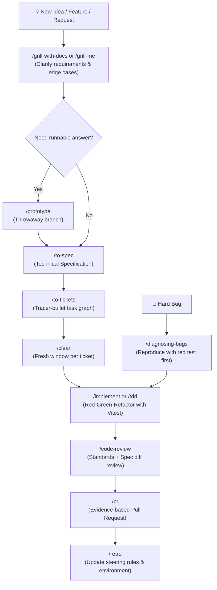

# Claude Skills & Engineering Playbook

> **Rohan Fullstack Lab — AI-Assisted Staff Engineering Guide**  
> How to build, refactor, and maintain high-scale systems using structured Claude Code agent skills.

---

## 🎯 1. Core Philosophy: Engineering vs. "Vibe Coding"

In modern engineering, the difference between a junior developer using AI and a **Staff Engineer (7+ YoE)** is not the prompt—it is the **discipline of verification and phased boundaries**:

1. **Never write implementation code before locking the seam**: We don't guess what to build; we interview, specify, model, and break work into tracer-bullet slices.
2. **Deterministic Feedback Loops**: We do not consider a task done because Claude says so. Work is done when an automated test passes, a diff passes two-axis review, and type checking is green.
3. **Context Hygiene**: Unbounded context degrades model reasoning. We keep high-context discussions together, clear context between independent tickets, and use subagents for heavy reading.

---

## 🗺️ 2. The Skill Map & Workflow Routing

When working on any task, invoke **`/ask-rohan`** to orient yourself, or follow this lifecycle:



---

## 📚 3. Skill Catalog by Lifecycle Phase

### Phase 1: Clarification & Ideation

| Skill               | Trigger / Slash Command | When to Reach For It                                       | How It Works                                                                                  |
| :------------------ | :---------------------- | :--------------------------------------------------------- | :-------------------------------------------------------------------------------------------- |
| **Ask Rohan**       | `/ask-rohan`            | You are unsure which skill or path to take.                | Routes you to the exact skill or flow based on your current state.                            |
| **Grill With Docs** | `/grill-with-docs`      | You have a feature idea and are working inside the repo.   | Relentlessly interviews you on trade-offs and persists conclusions to `GLOSSARY.md` and ADRs. |
| **Grill Me**        | `/grill-me`             | Stateless brainstorming (no files created).                | Rapid-fire interview to stress-test your thoughts before touching the code.                   |
| **Wait What**       | `/wait-what`            | Claude's explanation was convoluted or filled with jargon. | Re-pitches the last explanation in plain English using your lab's glossary.                   |

### Phase 2: Architecture, Modeling & Investigation

| Skill               | Trigger / Slash Command | When to Reach For It                               | How It Works                                                                             |
| :------------------ | :---------------------- | :------------------------------------------------- | :--------------------------------------------------------------------------------------- |
| **Domain Modeling** | `/domain-modeling`      | Designing entities, states, or relationships.      | Defines boundaries, aggregates, and records Architecture Decision Records (ADRs).        |
| **Codebase Design** | `/codebase-design`      | Structuring a new module, app, or package.         | Evaluates coupling, dependency inversion, and module boundaries.                         |
| **Prototype**       | `/prototype`            | A design question can't be settled on paper.       | Builds throwaway code on a `prototype/<name>` branch to verify UX or API ergonomics.     |
| **Research**        | `/research`             | Need deep documentation or external library study. | Launches a background agent to read primary sources and produce a cited markdown report. |

### Phase 3: Specification & Ticket Decomposition

| Skill          | Trigger / Slash Command | When to Reach For It                                | How It Works                                                                                                    |
| :------------- | :---------------------- | :-------------------------------------------------- | :-------------------------------------------------------------------------------------------------------------- |
| **To Spec**    | `/to-spec`              | You finished grilling and want a formal spec.       | Synthesizes conversation into a technical specification (seams, data models, error handling).                   |
| **To Tickets** | `/to-tickets`           | Spec is ready to be broken into buildable units.    | Generates **tracer-bullet vertical slices** with explicit blocking dependencies (`.scratch/<feature>/issues/`). |
| **Wayfinder**  | `/wayfinder`            | Long-running initiative spanning multiple sessions. | Creates a high-level roadmap and decision tracking map.                                                         |

### Phase 4: Implementation & Test-Driven Development

| Skill              | Trigger / Slash Command | When to Reach For It                                   | How It Works                                                                                       |
| :----------------- | :---------------------- | :----------------------------------------------------- | :------------------------------------------------------------------------------------------------- |
| **TDD**            | `/tdd`                  | Writing any business logic, API route, or helper.      | Strictly follows **Red -> Green -> Refactor**. Refuses to write code without a failing test first. |
| **Implement**      | `/implement`            | Working on a specific ticket from `/to-tickets`.       | Focuses on a single ticket, runs `/tdd`, and verifies completion before moving on.                 |
| **Implement Spec** | `/implement-spec`       | Large, multi-ticket spec ready for parallel execution. | Coordinates subagents across the task graph frontier to build an integration branch.               |

### Phase 5: Verification, Review & Pull Request

| Skill                    | Trigger / Slash Command          | When to Reach For It                             | How It Works                                                                                                |
| :----------------------- | :------------------------------- | :----------------------------------------------- | :---------------------------------------------------------------------------------------------------------- |
| **Diagnosing Bugs**      | `/diagnosing-bugs`               | An elusive bug or intermittent flake occurs.     | Refuses to guess. Creates a single reproduction command that goes red, then fixes it.                       |
| **Code Review**          | `/code-review`                   | Before merging a branch or opening a PR.         | Spawns two parallel subagents: **Standards** (lint/types/patterns) and **Spec** (fidelity to requirements). |
| **Improve Architecture** | `/improve-codebase-architecture` | Code works but feels coupled or rigid.           | Identifies seams, untangles dependencies, and introduces clean interfaces.                                  |
| **PR**                   | `/pr`                            | Creating a pull request.                         | Drafts a structured description with the smallest visual diff, before/after proof, and risk classification. |
| **Retro**                | `/retro`                         | After finishing a major feature or hard bug fix. | Analyzes what went wrong and suggests changes to your **environment** (linter rules, scripts, `CLAUDE.md`). |

---

## 🚀 4. Monorepo Real-World Scenarios

### Scenario A: Adding a New Backend Feature (e.g., Blog View Analytics)

1. **Clarify Requirements**:
   ```
   > /grill-with-docs
   "I want to track blog page views in Upstash Redis and sync them to MongoDB asynchronously."
   ```
   _Claude interviews you on concurrency, rate limiting per IP, batch write intervals, and failure modes._
2. **Generate Spec & Tickets**:
   ```
   > /to-spec
   > /to-tickets
   ```
   _Creates tickets under `.scratch/blog-analytics/issues/01-redis-counter.md`, `02-sync-worker.md`, etc._
3. **Execute via TDD**:
   ```
   > /clear
   > /implement .scratch/blog-analytics/issues/01-redis-counter.md
   ```
   _Claude writes a failing test in `apps/api/tests/`, implements the Redis atomic counter, and gets green._
4. **Review & PR**:
   ```
   > /code-review main
   > /pr
   ```

---

### Scenario B: Tracking Down a Tricky Bug (e.g., Slot Double-Booking)

1. **Never theorize blindly**:
   ```
   > /diagnosing-bugs
   "Users are able to book overlapping 30-minute slots if they click simultaneously."
   ```
2. **Reproduction Step**:
   _Claude creates a Vitest concurrency script in `apps/api/tests/` sending parallel requests._
3. **Lock Seam with Regression Test**:
   _The test goes RED (confirming race condition in MongoDB transaction / Redis lock)._
4. **Fix via TDD & Retro**:
   _Claude introduces atomic distributed locking, the test goes GREEN, and `/retro` updates API concurrency guidelines._

---

## 🧼 5. Context Hygiene & Window Management

To keep Claude Code operating at peak reasoning capacity (~150k token smart zone):

| Boundary                                         | Action                          | Why                                                                                      |
| :----------------------------------------------- | :------------------------------ | :--------------------------------------------------------------------------------------- |
| **Between `/grill-with-docs` and `/to-tickets`** | **KEEP SAME SESSION**           | The requirements, trade-offs, and ticket graph must share the exact same mental model.   |
| **Between Tickets in `/to-tickets`**             | **`/clear`**                    | Tickets are self-contained. Discarding old token clutter keeps the implementer sharp.    |
| **Large Reading Tasks (Docs, Logs, Diffs)**      | **Use Subagents / `/research`** | Never dump 5,000 lines of logs into the main conversation; delegate to a subagent.       |
| **Approaching 120k+ tokens**                     | **`/compact`**                  | Compresses historical discussion and keeps essentials before context degradation occurs. |
| **Switching Workspaces or Tools**                | **`/handoff`**                  | Writes a standalone context file to bridge work across sessions or colleagues.           |

---

## 🛡️ 6. Safety Guardrails & Git Discipline

This monorepo includes **`git-guardrails-claude-code`** (`.claude/skills/git-guardrails-claude-code/`).

- Claude Code is prevented from executing destructive commands:
  - `git push --force`
  - `git reset --hard`
  - `git clean -fd`
  - `git checkout .` / `git restore .`
- **Rule**: All destructive operations or irreversible production releases must be manually reviewed and triggered by the engineer.

---

## 🎯 7. Quick Command Reference

```bash
# Start an interactive guidance session:
/ask-rohan

# When starting a new feature:
/grill-with-docs -> /to-spec -> /to-tickets

# When implementing a ticket:
/implement -> /tdd

# When verifying code before git commit:
/code-review -> /pr

# When a bug occurs:
/diagnosing-bugs

# When learning a new engineering concept:
/teach
```
